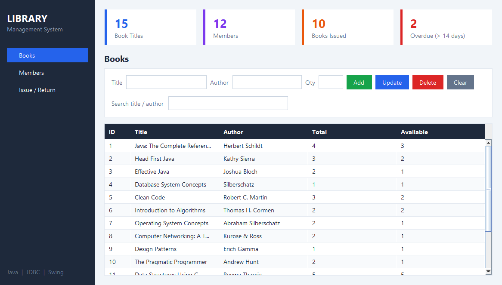
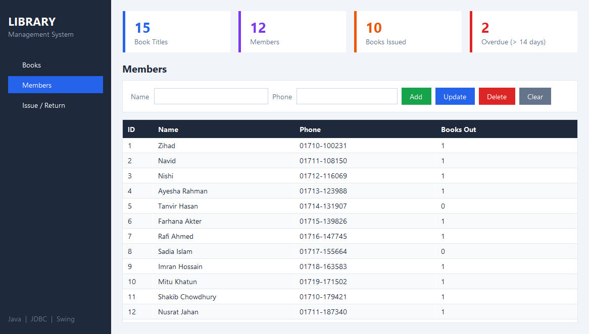
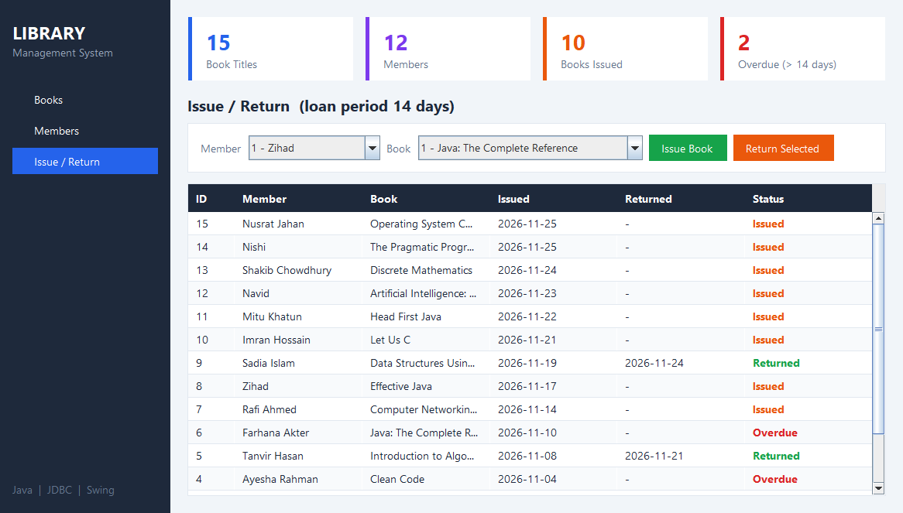

# Library Management System

A desktop Library Management System written in Java. The GUI is built with **Swing (JFrame)**, and the data is handled through **JDBC** with an SQLite database.

**Author:** Ahammed Zihad Khan — [@ahammedzihadkhan](https://github.com/ahammedzihadkhan)

## Features
- **Books:** add, update, delete, and live search by title or author. Shows total and available copies.
- **Members:** add, update and delete members, and see how many books each member has out.
- **Issue / Return:** issue a book to a member and return it. Overdue loans (more than 14 days) are highlighted.
- **Dashboard cards:** total titles, members, books issued and overdue books.

## JDBC concepts used
- `DriverManager.getConnection` to connect to SQLite
- `PreparedStatement` with `?` parameters for every query, which prevents SQL injection
- `CREATE TABLE` with `CHECK` and `FOREIGN KEY` constraints
- `JOIN` queries and sub-queries, for example to calculate available copies
- A transaction (`setAutoCommit(false)`, `commit`, `rollback`) when issuing a book

## Screenshots




## How to run
You need **JDK 17 or newer**. The SQLite JDBC driver is included in `lib/`.

- **Windows:** double-click `run.bat`
- **Any OS:**
  ```
  javac -cp lib/sqlite-jdbc.jar -d out src/*.java
  java -cp "out:lib/sqlite-jdbc.jar" LibraryApp
  ```
  On Windows, use `;` in place of `:` in the classpath.

On first run, `library.db` is created with sample data, including the members Zihad, Navid and Nishi.

## Tests
```
java -cp "out;lib/sqlite-jdbc.jar" SelfTest
```

## Project structure
```
src/Database.java     all JDBC code (connection, tables, queries)
src/LibraryApp.java   JFrame GUI
src/SelfTest.java     checks for the database logic
lib/sqlite-jdbc.jar   SQLite JDBC driver
screenshots/          app screenshots
```
